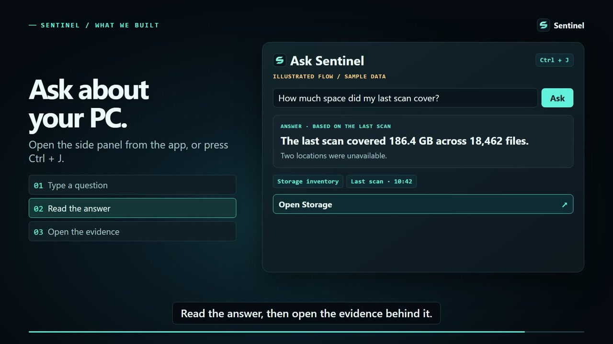

<p align="center">
  
</p>

<h1 align="center">Sentinel</h1>

<p align="center"><strong>Find out what’s making your Windows PC slow, full, or unstable.</strong></p>

<p align="center">
  <a href="#watch-the-demo">Demo</a> ·
  <a href="#what-you-can-explore">Features</a> ·
  <a href="#run-sentinel">Install &amp; build</a> ·
  <a href="#ai-and-privacy">AI &amp; privacy</a>
</p>

Sentinel is a Windows desktop app for investigating storage, performance, crashes, drivers, and security signals. It shows what Windows reported, explains why a finding matters, and points to the evidence so you can decide what to check next.

**Status:** Development preview for Windows 11. You can build and run the source below. The separate Windows app package is pending validation.

## Watch the demo

[](https://github.com/harshtries-code/sentinal/releases/download/project-explainer/sentinel-explainer.mp4)

[Download the three-minute explainer (1080p MP4)](https://github.com/harshtries-code/sentinal/releases/download/project-explainer/sentinel-explainer.mp4). The opening explains why we built Sentinel, how its Windows collectors and optional cloud AI work together, and how Ask Sentinel links an answer to scan evidence. The walkthrough uses labeled reference screens and sample data.

## What you can explore

| In Sentinel | What it helps you answer |
| --- | --- |
| **Overview and Storage** | What did my scan cover? Which folders use the most space? Which files need review or are protected? |
| **Performance and Drivers** | What is running or starting with Windows? Which devices have reported a problem? |
| **Threats** | What has Windows Defender reported? What can Sentinel establish about a selected file from local evidence? |
| **Crashes** | When did Windows record a crash or unexpected shutdown? Which event supports the explanation? |
| **Ask, History, and Reports** | What does a finding mean? What changed between scans? What evidence can I export for a technician? |

Threats brings Windows security evidence into the investigation. Microsoft Defender remains responsible for malware detection and protection. Sentinel’s driver changes, quarantine restore, and file cleanup actions are still being validated. Start with a scan of a small test folder and review the results before attempting any action. Photo diagnosis, a phone companion, and scheduled investigations are planned work.

## Run Sentinel

### Build and launch on Windows

Use Windows 11 x64, [Git](https://git-scm.com/download/win), and the [.NET 8 SDK for Windows](https://dotnet.microsoft.com/en-us/download/dotnet/8.0). Open a regular PowerShell window and run:

```powershell
git clone https://github.com/harshtries-code/sentinal.git
Set-Location sentinal
dotnet build .\src\Sentinel.sln --configuration Release
dotnet run --project .\src\Sentinel.App\Sentinel.App.csproj --configuration Release --no-build
```

The first build restores dependencies from NuGet. Start in **Overview**, choose a folder containing a few test files, and select **Scan**. Open **Storage** to see the largest items and the scan’s coverage. A cloud key is optional.

### Make a portable Windows folder

Build a folder you can copy to another Windows 11 x64 PC:

```powershell
dotnet publish .\src\Sentinel.App\Sentinel.App.csproj --configuration Release --runtime win-x64 --self-contained false --output .\out\sentinel-win-x64
```

Install the [.NET 8 Desktop Runtime for Windows x64](https://dotnet.microsoft.com/en-us/download/dotnet/8.0) on the destination PC, copy the **entire** `out\sentinel-win-x64` folder, and open `Sentinel.App.exe`. Keep its DLLs and other files alongside the executable. Use the same folder layout if you ZIP it for transfer.

### Run the tests

```powershell
dotnet test .\tests\Sentinel.Tests\Sentinel.Tests.csproj --configuration Release
```

Some tests require an opt-in environment or a Windows capability. Check the reported skips. Live driver, Defender, and recovery scenarios require separate validation in a disposable Windows VM.

## AI and privacy

- **Local scanning:** Sentinel inventories files and reads Windows signals on your PC. It stores scan history, settings, and saved reports under `%LOCALAPPDATA%\Sentinel`.
- **Optional AI:** In **Settings**, save your own Meta Model API key with access to the configured Muse Spark model and enable AI. Windows Credential Manager stores the key. Turn AI off in Settings to keep using local scans and views without model requests.
- **Bounded requests:** During a scan, the model can request read-only follow-up checks through Sentinel. It receives scoped evidence such as counts, metadata, and approved redacted excerpts. Whole drives and arbitrary file samples stay outside that workflow. Use **Show AI payload inspector** in Settings to see what was sent.
- **Actions:** The model can explain and propose. Sentinel handles supported actions through a separate Windows workflow with its own policy checks and confirmation.

## How it works

1. **Collect:** Windows collectors measure file sizes, inventory devices and processes, and read available events. They track access gaps alongside results.
2. **Investigate:** When AI is enabled, the model can ask bounded questions while collection is still running. Sentinel links its findings back to the recorded evidence.
3. **Review:** The WPF app shows the data and explanations together. Scan history and reports help you revisit findings or share them with a technician.

| Project | Role |
| --- | --- |
| [`Sentinel.App`](src/Sentinel.App/) | Native C# / WPF interface and scan workflow |
| [`Sentinel.Engine`](src/Sentinel.Engine/) | Windows collectors, classification, investigation tools, and action policy |
| [`Sentinel.Store`](src/Sentinel.Store/) | SQLite evidence, scan history, and local records |
| [`Sentinel.Tests`](tests/Sentinel.Tests/) | Automated tests for collectors, storage, AI boundaries, and application behavior |

## Feedback and license

Report reproducible problems in [GitHub Issues](https://github.com/harshtries-code/sentinal/issues). Include your Windows version, the steps you took, and what you expected. Remove personal paths, keys, and private file or event data from anything you attach.

The source is available to view in this public repository. A project license has yet to be selected. Third-party dependencies retain their own licenses.
